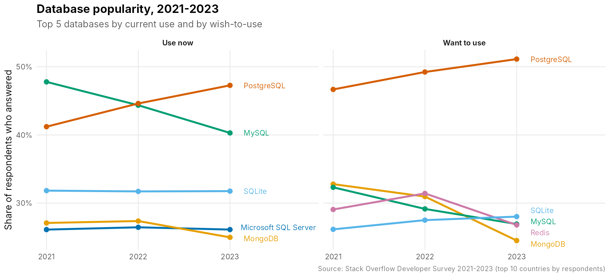

# What Do Developers Use? Stack Overflow Developer Survey 2021-2023


An end-to-end exploratory data analysis of three years of the Stack Overflow Developer Survey (**245,891 responses, 2021-2023**) in R. It cleans and combines the data, explores who responds and which programming languages and databases they use and want to use, and ends with evidence-based recommendations for Stack Overflow.

**Read the full report: [`stackoverflow_survey_report.md`](stackoverflow_survey_report.md)**



## Academic context

This project was created for the **R Programming for Data Science (ITRDA3-11)** module of the BSc Information Technology (Data Science) programme at **Eduvos** (NQF Level 7). The assessment asked students to import, tidy, transform and visualise the survey data with the tidyverse and to communicate the findings. The original brief is summarised in [`docs/project_brief.md`](docs/project_brief.md).

This repository is a **reworked and extended version** of my submission. I rebuilt the analysis as a reproducible, scripted workflow and corrected issues I found on review (see [What I improved](#what-i-improved)).

## Key findings

- **PostgreSQL overtook MySQL.** Current use went from 41% to 47% (PostgreSQL) and from 48% to 40% (MySQL) between 2021 and 2023, and PostgreSQL is the database people most want to use (51% in 2023).
- **The learner pipeline is shrinking.** People learning to code fell from 13.7% to 4.6% of respondents, while professional developers grew from 70% to 77%.
- **JavaScript, HTML/CSS, Python and SQL are stable; TypeScript is rising** (30% to 39% of respondents).
- **Rust is the language people most want to try**, and about 89% of its users want to keep using it.
- **Experience shapes the stack.** SQL use rises from 32% (0-2 years of coding) to 55% (20+ years), while Python and MongoDB are used most by newer developers.

## Questions answered

| Question | What it covers | Where |
|---|---|---|
| Q1 | Import and bind three years, standardise country names, handle missing values, choose a country subset | `R/01_import_clean.R` |
| Q2 | Categorise `MainBranch` and `EdLevel`; branch trends; branch vs age, country, education and years coding | `R/02_branch_education.R` |
| Q3 | Top 5 databases and languages (used and wanted); database trends; technologies wanted but not yet used | `R/03_databases_languages.R` |
| Q4 | Language trends; experience vs languages and databases; insights and recommendations | `R/04_experience_languages.R`, report |

## What I improved

Compared with my original submission, this version:

| Area | Original | This version |
|---|---|---|
| Branch categories | Matched "Student" and "Hobbyist" in text that never contains them, so learners (2022-23) and hobbyists fell into "Other" | Rules written against the real labels, with a note on the 2021 vs 2022-23 wording change |
| Country names | Replaced only a few strings | All 21 variant names standardised, including both Koreas; "Nomadic" removed |
| Missing values | Dropped rows with a missing country or years coding, with no explanation | Documented strategy per column, available-case analysis, no blanket row deletion |
| Years coding and age | Treated `YearsCode` as text, drew a box plot of `Age` (a text range) | `YearsCode` converted to numbers and bands; `Age` handled as an ordered factor |
| Q2d relationships | Age only | Age, education, country and years of coding, plus Cramér's V association strengths |
| Q3 popularity | "Used" only, as raw counts, with missing answers able to enter the top 5 | Used **and** wanted, as shares of people who answered, with missing answers excluded |
| Q3c / Q4 | Unlabelled count charts | Labelled trend lines, "want but not used" and retention analysis, experience heatmaps |
| Report | General statements not tied to the figures | Every number in the text is computed from the data, with detailed, actionable recommendations |
| Code | Duplicated blocks and stray lines in one script | Small reusable functions in `R/helpers.R`, one script per question, one `run_all.R` |
| Reporting | Word document | Quarto report with a GitHub-friendly Markdown version |

## Repository structure

```
.
├── stackoverflow_survey_report.qmd   # Quarto source of the report
├── stackoverflow_survey_report.md    # Rendered report (shows on GitHub)
├── R/
│   ├── helpers.R                     # cleaning functions, theme, utilities
│   ├── 01_import_clean.R             # Q1
│   ├── 02_branch_education.R         # Q2
│   ├── 03_databases_languages.R      # Q3
│   ├── 04_experience_languages.R     # Q4
│   └── run_all.R                     # runs the whole pipeline
├── figures/                          # charts used in the report
├── outputs/                          # summary tables (CSV)
├── data/
│   ├── README.md                     # how to download the survey data
│   ├── raw/                          # put survey_2021/22/23.csv here (git-ignored)
│   └── processed/                    # created by the pipeline (git-ignored)
├── docs/project_brief.md
├── install_packages.R
└── stackoverflow-survey-analysis.Rproj
```

## How to run it

1. Install R (4.3 or newer) and, optionally, RStudio and [Quarto](https://quarto.org).
2. Install the packages: `source("install_packages.R")`.
3. Download the three survey CSVs into `data/raw/` (see [`data/README.md`](data/README.md)).
4. Run the pipeline from the project root (open the `.Rproj` file in RStudio first):

```r
source("R/run_all.R")        # cleans the data, saves figures/ and outputs/
```

5. Render the report: `quarto render stackoverflow_survey_report.qmd`. This step only needs the summary tables in `outputs/`, not the raw data.

## Skills demonstrated

- Data import and combination: `readr::read_csv()` with `col_select`, `purrr::map2()`, `list_rbind()`
- Data cleaning and transformation with `dplyr`, `tidyr`, `stringr` and `forcats` (`case_when()`, `separate_longer_delim()`, regular expressions)
- Handling missing values, inconsistent categories and multi-select survey data
- Writing small reusable functions and keeping a clean project structure
- Exploratory data analysis, association measures (Cramér's V) and honest treatment of limitations
- Layered-grammar visualisation with `ggplot2`, `patchwork` and `ggrepel`
- Reproducible reporting with Quarto, and turning analysis into business recommendations

## Data and licence

The code is released under the MIT Licence (see [`LICENSE`](LICENSE)). The survey data belongs to Stack Overflow and is published under the Open Database Licence (ODbL) at <https://survey.stackoverflow.co/>. The assessment brief belongs to Eduvos and is described, not reproduced, in this repository.

## Author

**Buhle Malinga**, BSc IT (Data Science), Eduvos
Portfolio: [ctrlalt-buhle.github.io/portfolio](https://ctrlalt-buhle.github.io/portfolio/)
