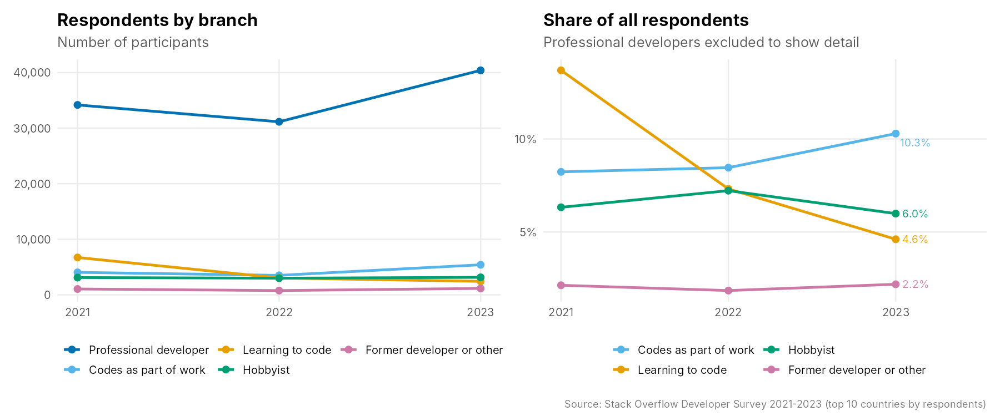
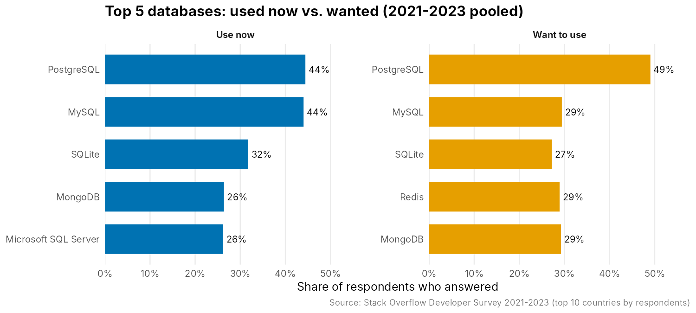
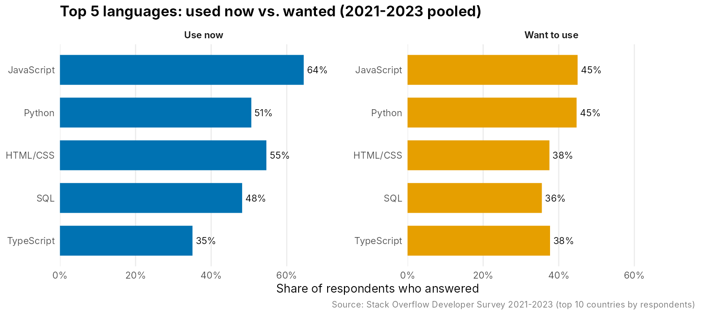
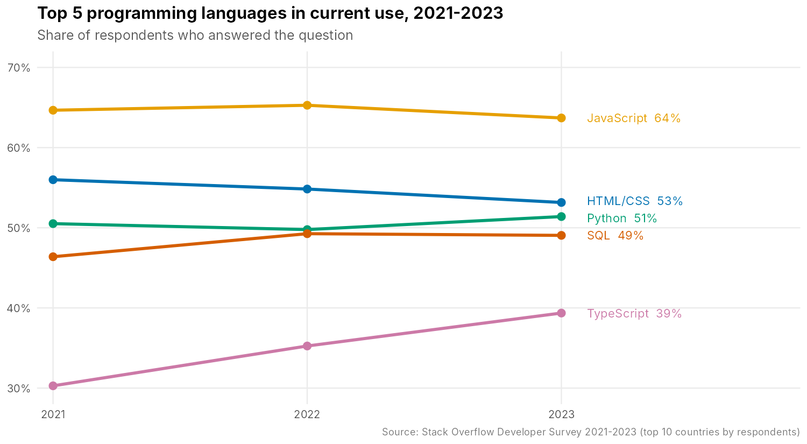

# What Do Developers Use? Stack Overflow Developer Survey 2021-2023
Buhle Malinga
2026-11-24

- [Summary](#summary)
- [1. Importing, combining and cleaning the data (Question
  1)](#1-importing-combining-and-cleaning-the-data-question-1)
  - [1a. Import and combine](#1a-import-and-combine)
  - [1b. One name per country](#1b-one-name-per-country)
  - [1c. Missing values and choosing the
    countries](#1c-missing-values-and-choosing-the-countries)
- [2. Who answers the survey? (Question
  2)](#2-who-answers-the-survey-question-2)
  - [2a. Branch categories](#2a-branch-categories)
  - [2b. Education categories](#2b-education-categories)
  - [2c. Branch participation over
    time](#2c-branch-participation-over-time)
  - [2d. How branch relates to age, country, education and years of
    coding](#2d-how-branch-relates-to-age-country-education-and-years-of-coding)
- [3. Databases and languages (Question
  3)](#3-databases-and-languages-question-3)
  - [3a. and 3b. Top 5 databases and languages: what people use and what
    they
    want](#3a-and-3b-top-5-databases-and-languages-what-people-use-and-what-they-want)
  - [3c. Database popularity over three
    years](#3c-database-popularity-over-three-years)
  - [Databases and languages people have not used yet but would like
    to](#databases-and-languages-people-have-not-used-yet-but-would-like-to)
- [4. Languages and experience (Question
  4)](#4-languages-and-experience-question-4)
  - [4a. Top 5 languages in current use over
    time](#4a-top-5-languages-in-current-use-over-time)
  - [4b. Years of coding vs. the top 5 languages and
    databases](#4b-years-of-coding-vs-the-top-5-languages-and-databases)
  - [4c. Insights and recommendations for Stack
    Overflow](#4c-insights-and-recommendations-for-stack-overflow)
    - [What the data tells us about
      users](#what-the-data-tells-us-about-users)
    - [Recommendations](#recommendations)
- [Limitations](#limitations)
- [References](#references)

# Summary

Stack Overflow wants to know which technologies its users work with and
want to learn, so that it can build better forums and learning material.
This report cleans and combines the 2021, 2022 and 2023 developer
surveys (245,891 responses) and analyses the 143,069 responses from the
ten countries with the most respondents.

**Key findings**

- **Professional developers are an ever larger share of respondents**
  (69.6% in 2021, 76.9% in 2023), while **people learning to code are
  shrinking fast** (13.7% to 4.6%).
- **PostgreSQL has overtaken MySQL** as the most used database (41.2% vs
  47.8% in 2021; 47.3% vs 40.3% in 2023). It is also the database people
  most want to use (51.1% in 2023), and 83% of its users want to keep
  using it.
- **JavaScript, HTML/CSS, Python and SQL are stable foundations;
  TypeScript is the one real riser** (30% to 39% of respondents).
- **Rust is the technology people most want to try**: 18.2% of
  respondents want it but have never used it, and 89% of current Rust
  users want to keep using it.
- **Experience changes what people use.** Newer coders lean on Python
  and MongoDB; veterans use more SQL and Microsoft SQL Server (SQL: 32%
  of 0-2 year coders vs 55% of 20+ year coders).

# 1. Importing, combining and cleaning the data (Question 1)

## 1a. Import and combine

The three survey files each have more than 80 columns and are up to 160
MB. Only the nine columns named in the brief are read (`col_select`),
every column is read as text so that each conversion is deliberate, and
a `Year` indicator column is added before the files are bound together
with `purrr::map2()` and `list_rbind()`. A unique respondent `id` is
added so that multi-select answers can be linked back to people later.

## 1b. One name per country

The survey uses formal names in some responses and common names in
others, and the formal names differ between years. The most important
cases are the two Koreas, which each appear under two names:

| Written as                                           | Standardised to |
|:-----------------------------------------------------|:----------------|
| Republic of Korea / South Korea                      | South Korea     |
| Democratic People’s Republic of Korea / North Korea  | North Korea     |
| United States of America                             | United States   |
| United Kingdom of Great Britain and Northern Ireland | United Kingdom  |
| Russian Federation                                   | Russia          |

In total 20 country labels were renamed (the full list is in
`outputs/country_name_standardisation.csv`). “Nomadic” is not a country,
so it was set to missing.

## 1c. Missing values and choosing the countries

| Column                 | Missing responses | % of all responses |
|:-----------------------|------------------:|-------------------:|
| DatabaseWantToWorkWith |            75,667 |              30.8% |
| DatabaseHaveWorkedWith |            42,789 |              17.4% |
| LanguageWantToWorkWith |            21,334 |               8.7% |
| YearsCode              |             5,484 |               2.2% |
| LanguageHaveWorkedWith |             5,419 |               2.2% |
| Age                    |             3,354 |               1.4% |
| EdLevel                |             3,221 |               1.3% |
| MainBranch             |                 0 |               0.0% |

How each kind of missing value was handled, and why:

- **Country** (1.2% missing): rows without a valid country were removed
  because country is the key used to choose the sample, and a missing
  country cannot be guessed. This is a small loss.
- **Age, education and years coding** (1-2% missing each): rows were
  kept, and a respondent is left out only of the specific chart or
  statistic that needs the missing value (available-case analysis).
  Dropping them everywhere would throw away valid language and database
  answers. Age answers of “Prefer not to say” were also treated as
  missing.
- **Language and database questions** (2% to 31% missing): an empty
  answer means the question was skipped, not that the person uses
  nothing. These respondents are therefore excluded from the
  **denominator** of that question, and popularity is reported as a
  *share of those who answered*. Counting them as “uses nothing” would
  understate every technology, and would do so more for databases than
  for languages.
- **Nothing was imputed.** Replacing a missing language or country with
  a guess would invent data for a categorical, multi-select survey with
  no good predictor.

**Choosing the countries.** The ten countries with the most respondents
were kept: United States, India, Germany, United Kingdom, Canada,
France, Brazil, Poland, Netherlands, Australia. Together they supply 59%
of all valid responses, and each has at least 5,186 respondents, so
every chart has stable estimates. Countries with a handful of responses
(some have fewer than five) would give noisy percentages and an
unreadable chart. The trade-off is that the results describe respondents
from large, mostly English-speaking or tech-heavy countries, not the
world.

| Step                                            |    Rows |
|:------------------------------------------------|--------:|
| Rows read (3 surveys combined)                  | 245,891 |
| Rows with a missing / non-country value removed |   2,860 |
| Rows outside the top 10 countries removed       |  99,962 |
| Rows in the analysis dataset                    | 143,069 |

# 2. Who answers the survey? (Question 2)

## 2a. Branch categories

The wording of `MainBranch` changed between years: 2021 says “a student
who is learning to code” while 2022 and 2023 say “learning to code”. The
categories below map all wordings to six stable groups (five after “None
of these” is merged with former developers, because those respondents
were not asked for a country in 2022-23 and so disappear from the
country-filtered data).

| Category | What it contains |
|:---|:---|
| Professional developer | “I am a developer by profession” |
| Codes as part of work | “Not primarily a developer, but I write code sometimes as part of my work” |
| Learning to code | “A student who is learning to code” (2021) / “I am learning to code” (2022-23) |
| Hobbyist | “I code primarily as a hobby” |
| Former developer or other | “Used to be a developer by profession” and “None of these” |

## 2b. Education categories

Eleven education labels were collapsed into seven ordered categories:
School (primary / secondary), Some college without a degree, Associate
degree, Bachelor’s degree, Master’s degree, Doctoral / professional
degree, and Other. The two “professional degree” labels (the wording
differs between years) and “other doctoral degree” form one group.

## 2c. Branch participation over time

**Observations**

1.  **Professional developers dominate and are growing.** They made up
    69.6% of respondents in 2021 and 76.9% in 2023.
2.  **Learners are disappearing from the survey.** People learning to
    code fell from 6,722 (13.7%) in 2021 to 2,421 (4.6%) in 2023. Part
    of the 2021 to 2022 drop may come from the changed question wording
    (see Limitations), but the decline continues from 2022 to 2023, when
    the wording did not change.
3.  **People who code as part of their work are rising** (8.2% to
    10.3%), which fits the spread of coding into non-developer jobs such
    as analytics.
4.  **Hobbyists are steady** at roughly 6-7% of respondents, and former
    developers are a small but growing group (2.1% to 2.2%).

## 2d. How branch relates to age, country, education and years of coding

| Variable        | Measure                                   | Strength |
|:----------------|:------------------------------------------|---------:|
| Age group       | Cramer’s V (0 = none, 1 = perfect)        |     0.35 |
| Education level | Cramer’s V (0 = none, 1 = perfect)        |     0.28 |
| Years of coding | Eta-squared (share of variance explained) |     0.12 |
| Country         | Cramer’s V (0 = none, 1 = perfect)        |     0.10 |

**Observations**

- **Age is the strongest link** (Cramér’s V = 0.35). 53% of hobbyists
  and 22% of learners are under 18, whereas former developers skew old
  (11% are 65 or older).
- **Education matters** (V = 0.28). The professional-developer share is
  85% among Bachelor’s graduates but only 31% among people whose highest
  education is school, who are mostly hobbyists and learners (many of
  them young).
- **Experience separates the groups clearly** (eta-squared = 0.12).
  Median years coding: professionals 12, people who code as part of work
  11, hobbyists 5, learners 3, and former developers 20.
- **Country has the weakest link** (V = 0.1), with one clear exception:
  **India**, where 21% of respondents are learning to code, against 5%
  in the United Kingdom.

# 3. Databases and languages (Question 3)

## 3a. and 3b. Top 5 databases and languages: what people use and what they want

Respondents can pick several technologies, so each answer was split on
“;” into one row per technology (`separate_longer_delim()`). Technology
names that differ between years (“Dynamodb”/“DynamoDB”,
“Matlab”/“MATLAB”) were merged first. Percentages are the share of
respondents who answered the question.

| Type     | Status      | Rank |           Technology | Share of answerers |
|:---------|:------------|:-----|---------------------:|-------------------:|
| Database | Use now     | 1    |           PostgreSQL |                44% |
| Database | Use now     | 2    |                MySQL |                44% |
| Database | Use now     | 3    |               SQLite |                32% |
| Database | Use now     | 4    |              MongoDB |                26% |
| Database | Use now     | 5    | Microsoft SQL Server |                26% |
| Database | Want to use | 1    |           PostgreSQL |                49% |
| Database | Want to use | 2    |                MySQL |                29% |
| Database | Want to use | 3    |              MongoDB |                29% |
| Database | Want to use | 4    |                Redis |                29% |
| Database | Want to use | 5    |               SQLite |                27% |
| Language | Use now     | 1    |           JavaScript |                64% |
| Language | Use now     | 2    |             HTML/CSS |                55% |
| Language | Use now     | 3    |               Python |                51% |
| Language | Use now     | 4    |                  SQL |                48% |
| Language | Use now     | 5    |           TypeScript |                35% |
| Language | Want to use | 1    |           JavaScript |                45% |
| Language | Want to use | 2    |               Python |                45% |
| Language | Want to use | 3    |           TypeScript |                38% |
| Language | Want to use | 4    |             HTML/CSS |                38% |
| Language | Want to use | 5    |                  SQL |                36% |

PostgreSQL and MySQL are neck and neck for current use, but PostgreSQL
wins clearly on **wanting to use** (49%). For languages the same top
five appear in both lists, but their order changes: HTML/CSS and SQL
rank second and fourth in use but fourth and fifth in desire, while
Python and TypeScript are more wanted than their current use suggests.

## 3c. Database popularity over three years

- **PostgreSQL rises, MySQL falls.** Current use: PostgreSQL 41.2% to
  47.3%; MySQL 47.8% to 40.3%. The lines crossed in 2022.
- **Desire for MongoDB is dropping**: 32.8% in 2021 to 24.5% in 2023,
  even though current use only slipped a little.
- **SQLite and Microsoft SQL Server are flat** in current use, which
  makes them the stable, embedded and enterprise choices.

## Databases and languages people have not used yet but would like to

The brief also asks which technologies users *have not yet used but
would like to*. For each respondent, the technologies they use were
subtracted from the ones they want.

- **Databases:** MongoDB (11.1%), PostgreSQL (10.9%), Redis (10.9%) and
  Elasticsearch (8.5%) lead the list.
- **Languages:** Rust (18.2%), Go (13.8%) and TypeScript (10.5%) stand
  out, and Rust also has the highest retention of any language with at
  least 2,000 users (89% of its users want to keep using it, against 71%
  for Python).

# 4. Languages and experience (Question 4)

## 4a. Top 5 languages in current use over time

JavaScript (64% in 2023), HTML/CSS, Python and SQL are very stable,
moving by only a few percentage points. **TypeScript is the exception**,
climbing from 30% to 39%. HTML/CSS drifts down slightly (56% to 53%).

## 4b. Years of coding vs. the top 5 languages and databases

- **Python is a newcomer’s language**: 60% of 3-5 year coders use it
  against 41% of those with 20+ years.
- **SQL grows with experience**: 32% of 0-2 year coders but 55% of
  veterans, a gap that suggests newer developers learn databases later.
- **TypeScript peaks in mid-career** (40% at 11-20 years vs 20% at 0-2
  years).
- **Databases split by generation**: MongoDB and MySQL are used most by
  people with under five years of coding (MongoDB 35% at 3-5 years vs
  17% at 20+), while Microsoft SQL Server grows steadily with experience
  (14% to 38%). PostgreSQL is far less used by the newest coders (28%)
  than by everyone else (39-49%).
- **Breadth of stack** rises quickly in the first years: respondents
  with 0-2 years report on average 4.3 languages and 2.2 databases,
  against 5.6 and 2.8 at 6-10 years, after which it levels off.

## 4c. Insights and recommendations for Stack Overflow

### What the data tells us about users

1.  **The community is increasingly professional and experienced**, and
    the beginner pipeline is thinning (learners: 13.7% to 4.6%). A
    platform that relies on today’s professionals needs tomorrow’s too.
2.  **The core stack is stable, and the movement is in databases**
    (PostgreSQL up, MySQL down) **and in what people want next** (Rust,
    Go, TypeScript; MongoDB, Redis, Elasticsearch).
3.  **Needs depend on experience.** Beginners focus on HTML/CSS,
    JavaScript and Python and have not yet reached SQL. Veterans work
    with SQL and enterprise databases. One forum design will not serve
    both.
4.  **Hobbyists and learners are young** (about half of hobbyists are
    under 18) **and concentrated in places like India**, so growth among
    learners is regional as well as generational.

### Recommendations

**1. Build a beginner on-ramp for Python, JavaScript and HTML/CSS.**
Learners fell by about two thirds in the survey, and the three languages
new coders use most are the same three that dominate the platform.
Create guided “Learn Python / Learn JavaScript” paths that link the best
existing answers into a sequence, add a question-asking assistant that
helps beginners write a good question before posting (a clear title,
what they tried, a minimal example), and mark beginner-friendly answers
with a badge. *Measure:* the share of new accounts that post or accept
an answer in their first 30 days, and the learner share in the next
survey.

**2. Add “Switching from X to Y” hubs around the migrations people
actually want.** 18.2% of respondents want to try Rust and 13.8% want to
try Go; MySQL use is falling while PostgreSQL keeps rising and retains
83% of its users. Publish curated collections (“From MySQL to
PostgreSQL”, “From Python to Go”, “From JavaScript to TypeScript”), seed
each with a starter-project template and a checklist of common
first-week errors, and run time-limited answer bounties on first-time
questions in those tags. *Measure:* answer rate and time-to-first-answer
for these tags, and the survey’s “want to use” to “have used”
conversion.

**3. Personalise by experience, not only by tag.** Technology use
changes with years of coding, so use experience as a signal in feeds and
suggestions. Show newer coders the next logical skill (only 32% of 0-2
year coders use SQL, against 55% of veterans), such as a “SQL for web
developers” series, and give experienced users depth: architecture,
performance, PostgreSQL internals, TypeScript at scale. *Measure:*
click-through and return visits for personalised vs. standard feeds in
an A/B test.

**4. Pair experienced and former developers with learners.** Former
developers have a median of 20 years of coding experience and are a
growing share of respondents, while learners have a median of 3. Create
a mentor role with recognition (a badge, visibility on answers) for
veterans who review beginner questions, and re-engage former developers
through a “return to code” newsletter built around the technologies they
know best (SQL Server and SQL grow with experience). *Measure:* mentor
sessions, beginner questions with an experienced reviewer, and veteran
retention.

**5. Localise the beginner programme where learners are.** India has 21%
learners among its respondents, about four times the United Kingdom’s
share. Run localised learning campaigns with university and bootcamp
partners and community meetups in these regions, and test translated
beginner guides. *Measure:* new-user sign-ups and activation by country.

**6. Keep measuring what changed.** Repeat this analysis for each survey
release, tracking five indicators: learner share, PostgreSQL share
vs. MySQL, TypeScript share, want-to-use to have-used conversion, and
the experience profile of new users.

# Limitations

- **Self-selected respondents.** The survey reaches people who visit
  Stack Overflow and chose to answer, so it describes the community, not
  all developers.
- **Wording changes.** The learner option changed from “a student who is
  learning to code” (2021) to “learning to code” (2022-23), so part of
  the 2021 to 2022 drop may be wording; the 2022 to 2023 decline is the
  cleaner signal. Some answer options (such as Bash/Shell) were also
  renamed, and I merged those that were obviously the same.
- **Top ten countries only.** Results describe large survey countries;
  small countries are not represented.
- **“Want to use” is not “will use”.** It records interest, and people
  may pick technologies they have only heard of.
- **Cross-sectional data.** Each year is a different group of
  respondents, so trends describe the community, not changes inside
  individual people.
- **Missing answers.** Database questions were skipped by 17-31% of
  respondents. Shares are based on people who answered, which assumes
  that skippers are similar to answerers.

# References

Stack Overflow (2021) *Stack Overflow Developer Survey 2021*. Available
at: <https://survey.stackoverflow.co/2021/> (Accessed: 11 February
2026).

Stack Overflow (2022) *Stack Overflow Developer Survey 2022*. Available
at: <https://survey.stackoverflow.co/2022/> (Accessed: 11 February
2026).

Stack Overflow (2023) *Stack Overflow Developer Survey 2023*. Available
at: <https://survey.stackoverflow.co/2023/> (Accessed: 12 February
2026).

R Core Team (2024) *R: A language and environment for statistical
computing*. Vienna: R Foundation for Statistical Computing. Available
at: <https://www.r-project.org/>.

Wickham, H. et al. (2019) ‘Welcome to the tidyverse’, *Journal of Open
Source Software*, 4(43), p. 1686. doi: 10.21105/joss.01686.

Wickham, H. (2016) *ggplot2: Elegant Graphics for Data Analysis*. New
York: Springer.

Pedersen, T. L. (2024) *patchwork: The Composer of Plots*. Available at:
<https://patchwork.data-imaginist.com/>.
