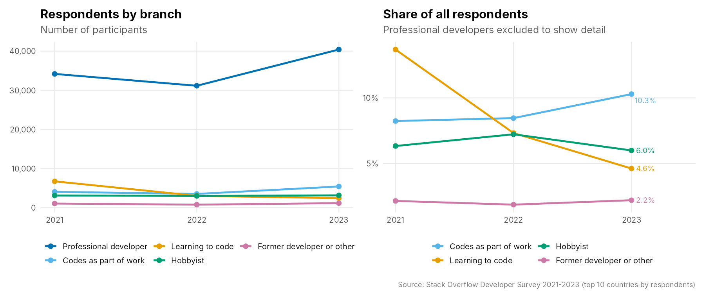
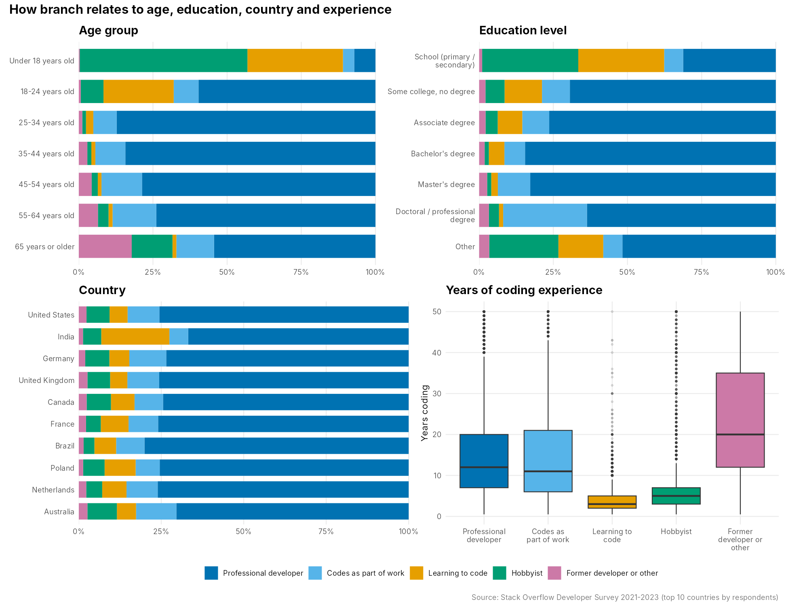
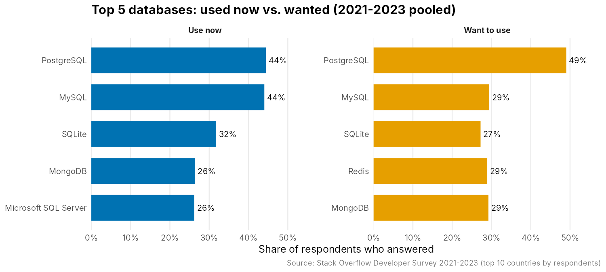
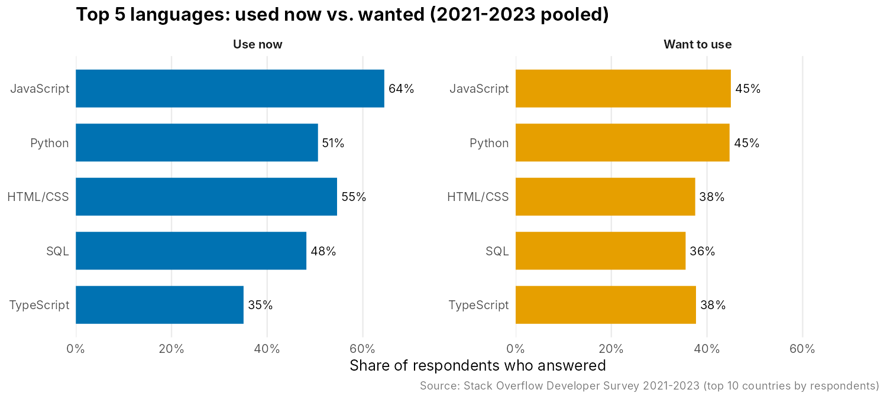
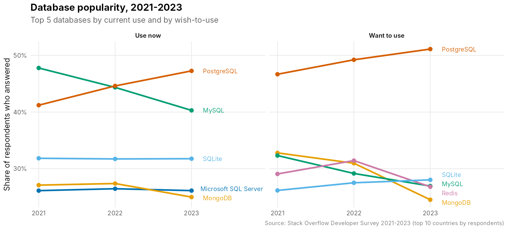
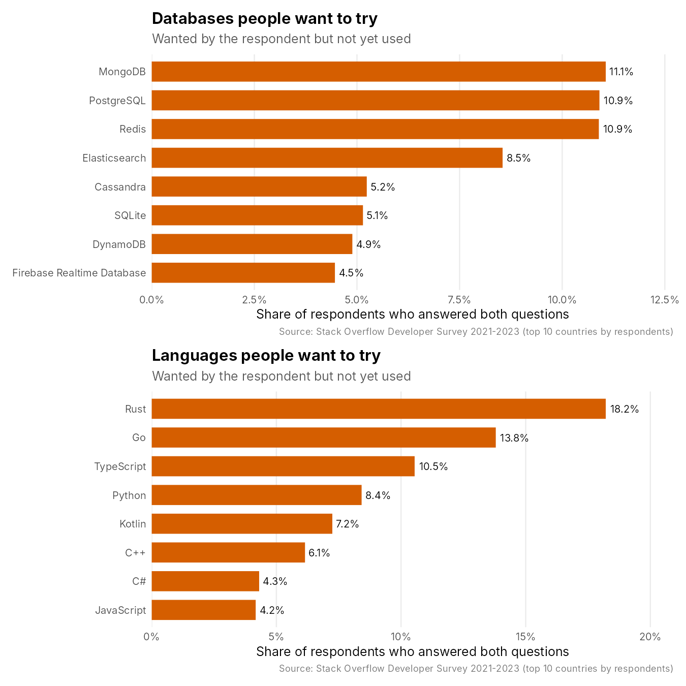
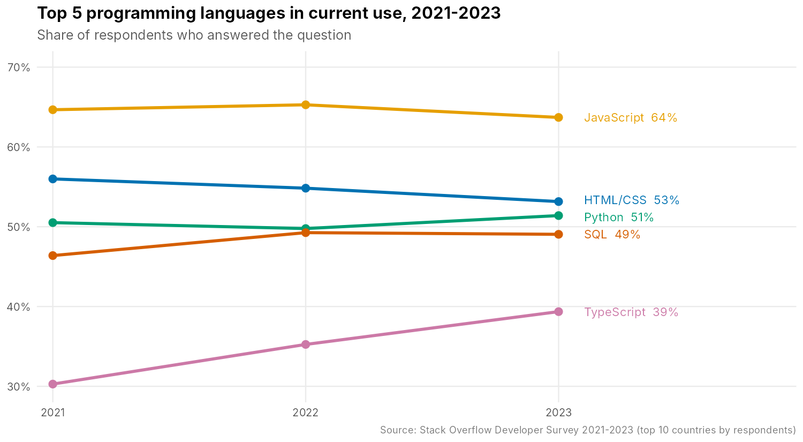
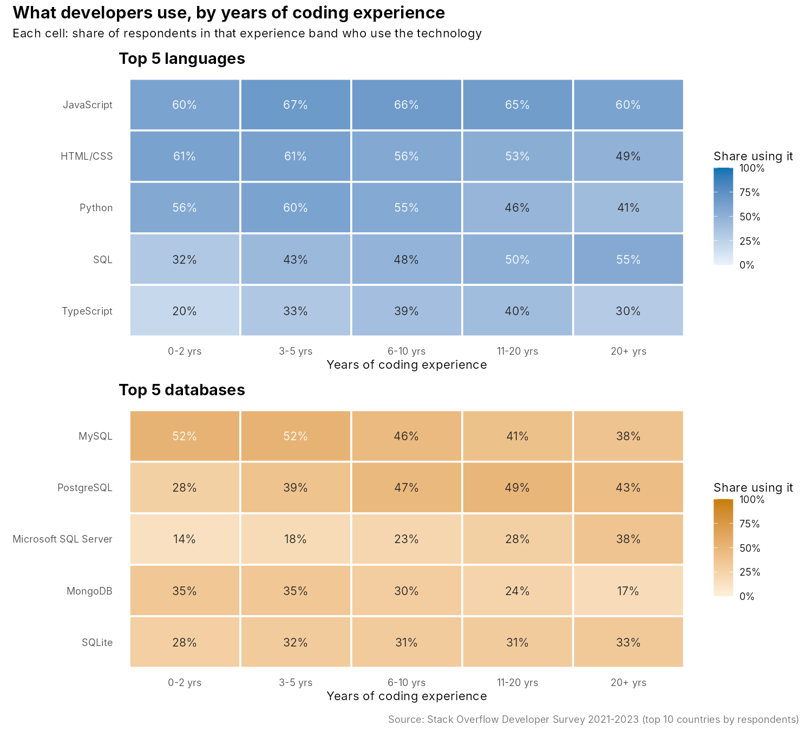

```{r setup}
# The report reads the tables produced by the pipeline in R/ (run R/run_all.R first)
# so it can be re-rendered without the 350 MB of raw survey files.
library(tidyverse)
library(scales)
library(knitr)

rd <- function(name) read_csv(file.path("outputs", paste0(name, ".csv")), show_col_types = FALSE)
pc <- function(x, d = 1) percent(x, accuracy = 10^-d)
nm <- function(x) format(round(x), big.mark = ",")

clog      <- rd("cleaning_log")
top10     <- rd("top10_countries")
miss      <- rd("missing_values_summary")
cnames    <- rd("country_name_standardisation")
by_year   <- rd("q2c_branch_by_year")
assoc     <- rd("q2d_association_strength")
by_age    <- rd("q2d_branch_by_age")
by_edu    <- rd("q2d_branch_by_education")
by_cty    <- rd("q2d_branch_by_country")
med_years <- rd("q2d_median_years_by_branch")
top5      <- rd("q3ab_top5_databases_languages")
db_trend  <- rd("q3c_database_trend")
db_wnu    <- rd("q3x_databases_want_not_used")
lang_wnu  <- rd("q3x_languages_want_not_used")
lang_ret  <- rd("q3x_language_retention")
db_ret    <- rd("q3x_database_retention")
lang_tr   <- rd("q4a_language_trend")
exp_tech  <- rd("q4b_experience_by_technology")
breadth   <- rd("q4b_stack_breadth_by_experience")

# small lookup helpers used in the text below
by_y   <- function(b, y) by_year |> filter(Branch == b, Year == y)
trend  <- function(df, t, y, s = NULL) df |> filter(tech == t, Year == y, if (is.null(s)) TRUE else status == s) |> pull(pct)
expv   <- function(ty, t, band) exp_tech |> filter(type == ty, tech == t, ExperienceBand == band) |> pull(pct)
wnu    <- function(df, t) df |> filter(tech == t) |> pull(pct)
ret    <- function(df, t) df |> filter(tech == t) |> pull(retention)
med    <- function(b) med_years |> filter(Branch == b) |> pull(median_years)
```

# Summary

Stack Overflow wants to know which technologies its users work with and want to learn, so that it can build better forums and learning material. This report cleans and combines the 2021, 2022 and 2023 developer surveys (`r nm(clog$rows[1])` responses) and analyses the `r nm(clog$rows[4])` responses from the ten countries with the most respondents.

**Key findings**

- **Professional developers are an ever larger share of respondents** (`r pc(by_y("Professional developer", 2021)$pct)` in 2021, `r pc(by_y("Professional developer", 2023)$pct)` in 2023), while **people learning to code are shrinking fast** (`r pc(by_y("Learning to code", 2021)$pct)` to `r pc(by_y("Learning to code", 2023)$pct)`).
- **PostgreSQL has overtaken MySQL** as the most used database (`r pc(trend(db_trend, "PostgreSQL", 2021, "Use now"))` vs `r pc(trend(db_trend, "MySQL", 2021, "Use now"))` in 2021; `r pc(trend(db_trend, "PostgreSQL", 2023, "Use now"))` vs `r pc(trend(db_trend, "MySQL", 2023, "Use now"))` in 2023). It is also the database people most want to use (`r pc(trend(db_trend, "PostgreSQL", 2023, "Want to use"))` in 2023), and `r pc(ret(db_ret, "PostgreSQL"), 0)` of its users want to keep using it.
- **JavaScript, HTML/CSS, Python and SQL are stable foundations; TypeScript is the one real riser** (`r pc(lang_tr |> filter(tech == "TypeScript", Year == 2021) |> pull(pct), 0)` to `r pc(lang_tr |> filter(tech == "TypeScript", Year == 2023) |> pull(pct), 0)` of respondents).
- **Rust is the technology people most want to try**: `r pc(wnu(lang_wnu, "Rust"))` of respondents want it but have never used it, and `r pc(ret(lang_ret, "Rust"), 0)` of current Rust users want to keep using it.
- **Experience changes what people use.** Newer coders lean on Python and MongoDB; veterans use more SQL and Microsoft SQL Server (SQL: `r pc(expv("Language", "SQL", "0-2 yrs"), 0)` of 0-2 year coders vs `r pc(expv("Language", "SQL", "20+ yrs"), 0)` of 20+ year coders).

# 1. Importing, combining and cleaning the data (Question 1)

## 1a. Import and combine

The three survey files each have more than 80 columns and are up to 160 MB. Only the nine columns named in the brief are read (`col_select`), every column is read as text so that each conversion is deliberate, and a `Year` indicator column is added before the files are bound together with `purrr::map2()` and `list_rbind()`. A unique respondent `id` is added so that multi-select answers can be linked back to people later.

## 1b. One name per country

The survey uses formal names in some responses and common names in others, and the formal names differ between years. The most important cases are the two Koreas, which each appear under two names:

| Written as | Standardised to |
|:---|:---|
| Republic of Korea / South Korea | South Korea |
| Democratic People's Republic of Korea / North Korea | North Korea |
| United States of America | United States |
| United Kingdom of Great Britain and Northern Ireland | United Kingdom |
| Russian Federation | Russia |

In total `r nrow(cnames) - 1` country labels were renamed (the full list is in `outputs/country_name_standardisation.csv`). "Nomadic" is not a country, so it was set to missing.

## 1c. Missing values and choosing the countries

```{r missing}
miss |>
  filter(column != "Country_std") |>
  transmute(Column = column, `Missing responses` = nm(n_missing), `% of all responses` = pc(pct_missing)) |>
  kable(align = "lrr")
```

How each kind of missing value was handled, and why:

- **Country** (`r pc(miss |> filter(column == "Country_std") |> pull(pct_missing))` missing): rows without a valid country were removed because country is the key used to choose the sample, and a missing country cannot be guessed. This is a small loss.
- **Age, education and years coding** (1-2% missing each): rows were kept, and a respondent is left out only of the specific chart or statistic that needs the missing value (available-case analysis). Dropping them everywhere would throw away valid language and database answers. Age answers of "Prefer not to say" were also treated as missing.
- **Language and database questions** (`r pc(miss |> filter(column == "LanguageHaveWorkedWith") |> pull(pct_missing), 0)` to `r pc(miss |> filter(column == "DatabaseWantToWorkWith") |> pull(pct_missing), 0)` missing): an empty answer means the question was skipped, not that the person uses nothing. These respondents are therefore excluded from the **denominator** of that question, and popularity is reported as a *share of those who answered*. Counting them as "uses nothing" would understate every technology, and would do so more for databases than for languages.
- **Nothing was imputed.** Replacing a missing language or country with a guess would invent data for a categorical, multi-select survey with no good predictor.

**Choosing the countries.** The ten countries with the most respondents were kept: `r paste(top10$Country, collapse = ", ")`. Together they supply `r pc(sum(top10$pct_of_valid), 0)` of all valid responses, and each has at least `r nm(min(top10$n))` respondents, so every chart has stable estimates. Countries with a handful of responses (some have fewer than five) would give noisy percentages and an unreadable chart. The trade-off is that the results describe respondents from large, mostly English-speaking or tech-heavy countries, not the world.

```{r cleanlog}
clog |> transmute(Step = step, Rows = nm(rows)) |> kable(align = "lr")
```

# 2. Who answers the survey? (Question 2)

## 2a. Branch categories

The wording of `MainBranch` changed between years: 2021 says "a student who is learning to code" while 2022 and 2023 say "learning to code". The categories below map all wordings to six stable groups (five after "None of these" is merged with former developers, because those respondents were not asked for a country in 2022-23 and so disappear from the country-filtered data).

| Category | What it contains |
|:---|:---|
| Professional developer | "I am a developer by profession" |
| Codes as part of work | "Not primarily a developer, but I write code sometimes as part of my work" |
| Learning to code | "A student who is learning to code" (2021) / "I am learning to code" (2022-23) |
| Hobbyist | "I code primarily as a hobby" |
| Former developer or other | "Used to be a developer by profession" and "None of these" |

## 2b. Education categories

Eleven education labels were collapsed into seven ordered categories: School (primary / secondary), Some college without a degree, Associate degree, Bachelor's degree, Master's degree, Doctoral / professional degree, and Other. The two "professional degree" labels (the wording differs between years) and "other doctoral degree" form one group.

## 2c. Branch participation over time



**Observations**

1. **Professional developers dominate and are growing.** They made up `r pc(by_y("Professional developer", 2021)$pct)` of respondents in 2021 and `r pc(by_y("Professional developer", 2023)$pct)` in 2023.
2. **Learners are disappearing from the survey.** People learning to code fell from `r nm(by_y("Learning to code", 2021)$n)` (`r pc(by_y("Learning to code", 2021)$pct)`) in 2021 to `r nm(by_y("Learning to code", 2023)$n)` (`r pc(by_y("Learning to code", 2023)$pct)`) in 2023. Part of the 2021 to 2022 drop may come from the changed question wording (see Limitations), but the decline continues from 2022 to 2023, when the wording did not change.
3. **People who code as part of their work are rising** (`r pc(by_y("Codes as part of work", 2021)$pct)` to `r pc(by_y("Codes as part of work", 2023)$pct)`), which fits the spread of coding into non-developer jobs such as analytics.
4. **Hobbyists are steady** at roughly 6-7% of respondents, and former developers are a small but growing group (`r pc(by_y("Former developer or other", 2021)$pct)` to `r pc(by_y("Former developer or other", 2023)$pct)`).

## 2d. How branch relates to age, country, education and years of coding



```{r assoc}
assoc |> transmute(Variable = variable, Measure = measure, Strength = round(strength, 2)) |> kable(align = "llr")
```

**Observations**

- **Age is the strongest link** (Cramér's V = `r round(assoc |> filter(variable == "Age group") |> pull(strength), 2)`). `r pc(by_age |> filter(Branch == "Hobbyist", AgeGroup == "Under 18 years old") |> pull(pct), 0)` of hobbyists and `r pc(by_age |> filter(Branch == "Learning to code", AgeGroup == "Under 18 years old") |> pull(pct), 0)` of learners are under 18, whereas former developers skew old (`r pc(by_age |> filter(Branch == "Former developer or other", AgeGroup == "65 years or older") |> pull(pct), 0)` are 65 or older).
- **Education matters** (V = `r round(assoc |> filter(variable == "Education level") |> pull(strength), 2)`). The professional-developer share is `r pc(by_edu |> filter(Education == "Bachelor's degree", Branch == "Professional developer") |> pull(pct), 0)` among Bachelor's graduates but only `r pc(by_edu |> filter(Education == "School (primary / secondary)", Branch == "Professional developer") |> pull(pct), 0)` among people whose highest education is school, who are mostly hobbyists and learners (many of them young).
- **Experience separates the groups clearly** (eta-squared = `r round(assoc |> filter(variable == "Years of coding") |> pull(strength), 2)`). Median years coding: professionals `r med("Professional developer")`, people who code as part of work `r med("Codes as part of work")`, hobbyists `r med("Hobbyist")`, learners `r med("Learning to code")`, and former developers `r med("Former developer or other")`.
- **Country has the weakest link** (V = `r round(assoc |> filter(variable == "Country") |> pull(strength), 2)`), with one clear exception: **India**, where `r pc(by_cty |> filter(Country == "India", Branch == "Learning to code") |> pull(pct), 0)` of respondents are learning to code, against `r pc(by_cty |> filter(Country == "United Kingdom", Branch == "Learning to code") |> pull(pct), 0)` in the United Kingdom.

# 3. Databases and languages (Question 3)

## 3a. and 3b. Top 5 databases and languages: what people use and what they want

Respondents can pick several technologies, so each answer was split on ";" into one row per technology (`separate_longer_delim()`). Technology names that differ between years ("Dynamodb"/"DynamoDB", "Matlab"/"MATLAB") were merged first. Percentages are the share of respondents who answered the question.

```{r top5}
top5 |>
  mutate(`Share of answerers` = pc(pct_of_answerers, 0)) |>
  select(Type = type, Status = status, Rank = rank, Technology = tech, `Share of answerers`) |>
  kable(align = "lllrr")
```





PostgreSQL and MySQL are neck and neck for current use, but PostgreSQL wins clearly on **wanting to use** (`r pc(top5 |> filter(type == "Database", status == "Want to use", rank == 1) |> pull(pct_of_answerers), 0)`). For languages the same top five appear in both lists, but their order changes: HTML/CSS and SQL rank second and fourth in use but fourth and fifth in desire, while Python and TypeScript are more wanted than their current use suggests.

## 3c. Database popularity over three years



- **PostgreSQL rises, MySQL falls.** Current use: PostgreSQL `r pc(trend(db_trend, "PostgreSQL", 2021, "Use now"))` to `r pc(trend(db_trend, "PostgreSQL", 2023, "Use now"))`; MySQL `r pc(trend(db_trend, "MySQL", 2021, "Use now"))` to `r pc(trend(db_trend, "MySQL", 2023, "Use now"))`. The lines crossed in 2022.
- **Desire for MongoDB is dropping**: `r pc(trend(db_trend, "MongoDB", 2021, "Want to use"))` in 2021 to `r pc(trend(db_trend, "MongoDB", 2023, "Want to use"))` in 2023, even though current use only slipped a little.
- **SQLite and Microsoft SQL Server are flat** in current use, which makes them the stable, embedded and enterprise choices.

## Databases and languages people have not used yet but would like to

The brief also asks which technologies users *have not yet used but would like to*. For each respondent, the technologies they use were subtracted from the ones they want.



- **Databases:** MongoDB (`r pc(wnu(db_wnu, "MongoDB"))`), PostgreSQL (`r pc(wnu(db_wnu, "PostgreSQL"))`), Redis (`r pc(wnu(db_wnu, "Redis"))`) and Elasticsearch (`r pc(wnu(db_wnu, "Elasticsearch"))`) lead the list.
- **Languages:** Rust (`r pc(wnu(lang_wnu, "Rust"))`), Go (`r pc(wnu(lang_wnu, "Go"))`) and TypeScript (`r pc(wnu(lang_wnu, "TypeScript"))`) stand out, and Rust also has the highest retention of any language with at least 2,000 users (`r pc(ret(lang_ret, "Rust"), 0)` of its users want to keep using it, against `r pc(ret(lang_ret, "Python"), 0)` for Python).

# 4. Languages and experience (Question 4)

## 4a. Top 5 languages in current use over time



JavaScript (`r pc(lang_tr |> filter(tech == "JavaScript", Year == 2023) |> pull(pct), 0)` in 2023), HTML/CSS, Python and SQL are very stable, moving by only a few percentage points. **TypeScript is the exception**, climbing from `r pc(lang_tr |> filter(tech == "TypeScript", Year == 2021) |> pull(pct), 0)` to `r pc(lang_tr |> filter(tech == "TypeScript", Year == 2023) |> pull(pct), 0)`. HTML/CSS drifts down slightly (`r pc(lang_tr |> filter(tech == "HTML/CSS", Year == 2021) |> pull(pct), 0)` to `r pc(lang_tr |> filter(tech == "HTML/CSS", Year == 2023) |> pull(pct), 0)`).

## 4b. Years of coding vs. the top 5 languages and databases



- **Python is a newcomer's language**: `r pc(expv("Language", "Python", "3-5 yrs"), 0)` of 3-5 year coders use it against `r pc(expv("Language", "Python", "20+ yrs"), 0)` of those with 20+ years.
- **SQL grows with experience**: `r pc(expv("Language", "SQL", "0-2 yrs"), 0)` of 0-2 year coders but `r pc(expv("Language", "SQL", "20+ yrs"), 0)` of veterans, a gap that suggests newer developers learn databases later.
- **TypeScript peaks in mid-career** (`r pc(expv("Language", "TypeScript", "11-20 yrs"), 0)` at 11-20 years vs `r pc(expv("Language", "TypeScript", "0-2 yrs"), 0)` at 0-2 years).
- **Databases split by generation**: MongoDB and MySQL are used most by people with under five years of coding (MongoDB `r pc(expv("Database", "MongoDB", "3-5 yrs"), 0)` at 3-5 years vs `r pc(expv("Database", "MongoDB", "20+ yrs"), 0)` at 20+), while Microsoft SQL Server grows steadily with experience (`r pc(expv("Database", "Microsoft SQL Server", "0-2 yrs"), 0)` to `r pc(expv("Database", "Microsoft SQL Server", "20+ yrs"), 0)`). PostgreSQL is far less used by the newest coders (`r pc(expv("Database", "PostgreSQL", "0-2 yrs"), 0)`) than by everyone else (39-49%).
- **Breadth of stack** rises quickly in the first years: respondents with 0-2 years report on average `r round(breadth |> filter(type == "Languages", ExperienceBand == "0-2 yrs") |> pull(avg), 1)` languages and `r round(breadth |> filter(type == "Databases", ExperienceBand == "0-2 yrs") |> pull(avg), 1)` databases, against `r round(breadth |> filter(type == "Languages", ExperienceBand == "6-10 yrs") |> pull(avg), 1)` and `r round(breadth |> filter(type == "Databases", ExperienceBand == "6-10 yrs") |> pull(avg), 1)` at 6-10 years, after which it levels off.

## 4c. Insights and recommendations for Stack Overflow

### What the data tells us about users

1. **The community is increasingly professional and experienced**, and the beginner pipeline is thinning (learners: `r pc(by_y("Learning to code", 2021)$pct)` to `r pc(by_y("Learning to code", 2023)$pct)`). A platform that relies on today's professionals needs tomorrow's too.
2. **The core stack is stable, and the movement is in databases** (PostgreSQL up, MySQL down) **and in what people want next** (Rust, Go, TypeScript; MongoDB, Redis, Elasticsearch).
3. **Needs depend on experience.** Beginners focus on HTML/CSS, JavaScript and Python and have not yet reached SQL. Veterans work with SQL and enterprise databases. One forum design will not serve both.
4. **Hobbyists and learners are young** (about half of hobbyists are under 18) **and concentrated in places like India**, so growth among learners is regional as well as generational.

### Recommendations

**1. Build a beginner on-ramp for Python, JavaScript and HTML/CSS.**
Learners fell by about two thirds in the survey, and the three languages new coders use most are the same three that dominate the platform. Create guided "Learn Python / Learn JavaScript" paths that link the best existing answers into a sequence, add a question-asking assistant that helps beginners write a good question before posting (a clear title, what they tried, a minimal example), and mark beginner-friendly answers with a badge. *Measure:* the share of new accounts that post or accept an answer in their first 30 days, and the learner share in the next survey.

**2. Add "Switching from X to Y" hubs around the migrations people actually want.**
`r pc(wnu(lang_wnu, "Rust"))` of respondents want to try Rust and `r pc(wnu(lang_wnu, "Go"))` want to try Go; MySQL use is falling while PostgreSQL keeps rising and retains `r pc(ret(db_ret, "PostgreSQL"), 0)` of its users. Publish curated collections ("From MySQL to PostgreSQL", "From Python to Go", "From JavaScript to TypeScript"), seed each with a starter-project template and a checklist of common first-week errors, and run time-limited answer bounties on first-time questions in those tags. *Measure:* answer rate and time-to-first-answer for these tags, and the survey's "want to use" to "have used" conversion.

**3. Personalise by experience, not only by tag.**
Technology use changes with years of coding, so use experience as a signal in feeds and suggestions. Show newer coders the next logical skill (only `r pc(expv("Language", "SQL", "0-2 yrs"), 0)` of 0-2 year coders use SQL, against `r pc(expv("Language", "SQL", "20+ yrs"), 0)` of veterans), such as a "SQL for web developers" series, and give experienced users depth: architecture, performance, PostgreSQL internals, TypeScript at scale. *Measure:* click-through and return visits for personalised vs. standard feeds in an A/B test.

**4. Pair experienced and former developers with learners.**
Former developers have a median of `r med("Former developer or other")` years of coding experience and are a growing share of respondents, while learners have a median of `r med("Learning to code")`. Create a mentor role with recognition (a badge, visibility on answers) for veterans who review beginner questions, and re-engage former developers through a "return to code" newsletter built around the technologies they know best (SQL Server and SQL grow with experience). *Measure:* mentor sessions, beginner questions with an experienced reviewer, and veteran retention.

**5. Localise the beginner programme where learners are.**
India has `r pc(by_cty |> filter(Country == "India", Branch == "Learning to code") |> pull(pct), 0)` learners among its respondents, about four times the United Kingdom's share. Run localised learning campaigns with university and bootcamp partners and community meetups in these regions, and test translated beginner guides. *Measure:* new-user sign-ups and activation by country.

**6. Keep measuring what changed.**
Repeat this analysis for each survey release, tracking five indicators: learner share, PostgreSQL share vs. MySQL, TypeScript share, want-to-use to have-used conversion, and the experience profile of new users.

# Limitations

- **Self-selected respondents.** The survey reaches people who visit Stack Overflow and chose to answer, so it describes the community, not all developers.
- **Wording changes.** The learner option changed from "a student who is learning to code" (2021) to "learning to code" (2022-23), so part of the 2021 to 2022 drop may be wording; the 2022 to 2023 decline is the cleaner signal. Some answer options (such as Bash/Shell) were also renamed, and I merged those that were obviously the same.
- **Top ten countries only.** Results describe large survey countries; small countries are not represented.
- **"Want to use" is not "will use".** It records interest, and people may pick technologies they have only heard of.
- **Cross-sectional data.** Each year is a different group of respondents, so trends describe the community, not changes inside individual people.
- **Missing answers.** Database questions were skipped by 17-31% of respondents. Shares are based on people who answered, which assumes that skippers are similar to answerers.

# References

Stack Overflow (2021) *Stack Overflow Developer Survey 2021*. Available at: <https://survey.stackoverflow.co/2021/> (Accessed: 11 February 2026).

Stack Overflow (2022) *Stack Overflow Developer Survey 2022*. Available at: <https://survey.stackoverflow.co/2022/> (Accessed: 11 February 2026).

Stack Overflow (2023) *Stack Overflow Developer Survey 2023*. Available at: <https://survey.stackoverflow.co/2023/> (Accessed: 12 February 2026).

R Core Team (2024) *R: A language and environment for statistical computing*. Vienna: R Foundation for Statistical Computing. Available at: <https://www.r-project.org/>.

Wickham, H. et al. (2019) 'Welcome to the tidyverse', *Journal of Open Source Software*, 4(43), p. 1686. doi: 10.21105/joss.01686.

Wickham, H. (2016) *ggplot2: Elegant Graphics for Data Analysis*. New York: Springer.

Pedersen, T. L. (2024) *patchwork: The Composer of Plots*. Available at: <https://patchwork.data-imaginist.com/>.
